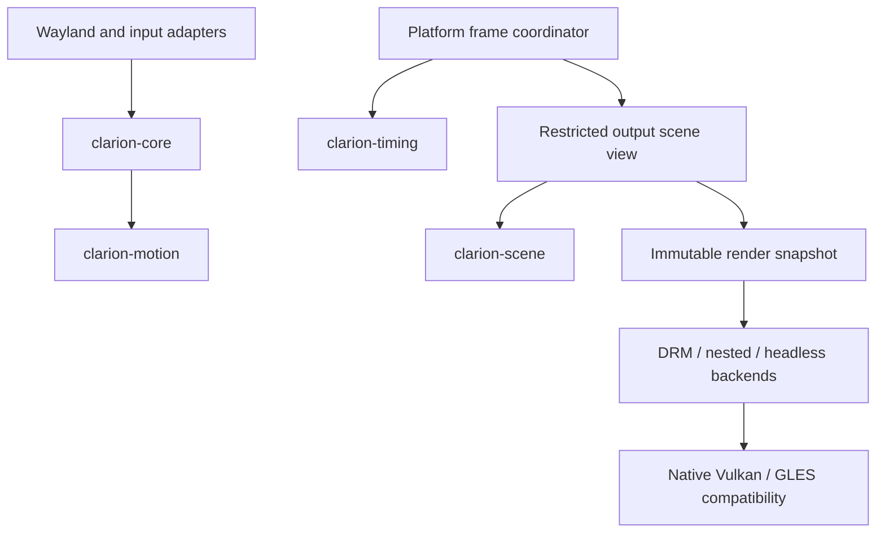

# Clarion architecture

Clarion is a modular Wayland compositor. Desktop decisions, animation mathematics,
presentation scheduling and composition policy are independently compiled Rust
crates. The compositor executable owns protocol and device resources on its event
thread; workers receive bounded jobs and resource leases, never the desktop owner.

## Module responsibilities

| Module | Owns | Must not own |
| --- | --- | --- |
| `clarion-core` | Window and space identity, focus, layout policies, interaction state | Wayland objects, renderers, event loop |
| `clarion-motion` | Curves, springs, trajectories, rate clock, overscroll mathematics | Desktop model, GPU, protocol |
| `clarion-timing` | Per-output presentation prediction, budget, scheduling transitions | Renderer, protocol, desktop model |
| `clarion-scene` | Immutable composition pass order and privacy routes | Renderer, client buffers, desktop model |
| `src/scene` | Output-specific composition views, render elements, effect lifecycle | Full compositor owner, event-loop access, input dispatch |
| `src/platform` | Input/protocol/device translation, asynchronous completion delivery | A second desktop policy engine |
| `src/backend` | DRM/KMS, nested and headless output submission | Full desktop, focus, layout or input access |
| `src/render_helpers/vulkan` | Native Vulkan resources, pipelines, imports and retirement | Desktop and input policy |
| `src/render_helpers/vulkan/lifecycle` | Bounded worker registration, GPU leases and process exit barriers | Desktop objects, frame scheduling or renderer ownership |
| `clarion-ipc` | Versioned requests, responses and diagnostics | Desktop implementation |
| `clarion-config` | Configuration decoding, schema and identity migration | Device ownership |
| `clarion-shell`, `clarion-settings` | Desktop UI and configuration UI | Compositor core ownership |

## Ownership and boundaries

`DesktopCore` owns stable semantic identity and interaction state. Floating,
scrolling-column and BSP policies implement one numerical arrangement interface.
Permanent client adapters apply actual client constraints and configure
transactions; keeping a `Tile` or `WlSurface` there does not create another core.

The frame coordinator captures scheduling policy and projects only the references
needed by an output scene. `layout::scene_source` captures the selected output's
composition flags, matching moving tile and its transform. `MonitorScene` stores
one mutually exclusive inline ordinary, Stage, Spread or Cube composition,
without retaining a complete monitor or unused parallel composition storage. Popup/background passes
reuse the captured workspace descriptors rather than rebuilding geometry. MRU
receives only an ID-to-window lookup capability. Effect lifecycle updates consume
geometry/color values. Scene code cannot borrow `Layout`, `Monitor`, `Workspace`
or the core, and cannot recover the complete compositor or event loop. Locked
and screenshot-selection routes acquire an empty desktop source. A detached
source keeps shell/background passes without requesting workspace renderers.
These are renderer-dependent read views. Strong retained rendering resources
belong to scene registries; layout holds weak registrations. Stage, Spread and
Cube composition, target cleanup and renderer cache invalidation live in scene
modules. Window drawing, opening, minimization, elastic prediction and snapshot
execution live in scene modules. Compatibility entries in layout delegate to the
same implementation. These borrowed preparation capabilities are not a fully
detached GPU-neutral retained scene graph. The specialized migration
and launcher work is documented in
[the scene migration note](docs/clarion-specialized-scenes-20261016.md).
Backends consume a frozen element slice through a
restricted frame port. Display, capture and headless rendering share the same
composition implementation and privacy routes.

## Window presentation boundary

`Tile` retains window identity, placement and a `WindowPresentationState` with
numeric trajectories and immutable style values. The scene receives a window
render capability, a borrowed numeric state and one temporary resource lease;
neither ordinary composition nor moving-window composition retains `&Tile`.
The scene registry owns borders, focus rings, shadows, fullscreen and rounded
corner buffers, offscreen animation images, mesh identities and forecast caches.
Initial style configures the registered decoration set without replacing it or
allocating another set of IDs.

Opening models produce a copyable numeric pose. Shared GLES/Vulkan shader geometry
consumes that pose, including fractional scale, negative decoration offsets and
the used prefix of a pooled texture. Genie trajectories retain reversal and
reflow continuity; a separate scene cache keys the complete numeric pose and
texture commit. Wobble advances only at owner event time. Scene prediction uses
an independent numeric copy and never writes predicted nodes back to the owner.
Its mesh identity, damage revision and cached vertices belong to the scene.

Render failures enqueue coalesced effect-retirement requests rather than changing
numeric animation state. The owner consumes them during its next animation
update. A scene-owned wakeup bit requests one owner frame on all outputs, including
previously sampled cross-output bounds, even after a static render; scene code receives no event loop. Busy preserves the current pose,
retained images and existing requests. Parked windows keep their exclusive Genie
route until the owner retires it.

Snapshot and interrupted-resize capture accept the same restricted scene view
or a numeric blend pose. Native closing pins the exact client attachment before
fallible capture, and preserves separate Output, Screencast and ScreenCapture
images. A capture-local deferred scope restores inherited retry state on return,
error or unwind. Any deferred target aborts the whole capture with typed Busy;
partial results are not cached as complete snapshots. GLES temporarily redirects
private backgrounds through an unwind-safe Xray slot guard. Renderer replacement
retires native images while preserving the attachment lease needed by closing.

Layout still orchestrates some close/configure transactions through compatibility
entries. Workspace and Expo retain other presentation objects. Cold exact-size
allocation, unowned DMA-BUF synchronization and GLES snapshot freezing retain
their documented compatibility contracts. This boundary does not assert that
all inherited runtime code or every synchronous driver operation was removed.

Animation time projection is output-local. Real interaction state advances once;
rendering a prediction or capture must not advance another output's canonical
state. Effects invalidate their previous and new bounds, retain resources until
GPU completion, and release their final animation state after cleanup.

GPU compilation, preparation and retirement use bounded work. Overload defers a
scene and preserves presentation-gap accounting rather than blocking for queue
capacity. Device recovery must publish a generation-checked prepared device to
the owner thread; desktop state and non-Send renderer caches stay on that thread.
Compatibility synchronization remains explicit and depends on device capability.

The process lifecycle registers preparation, completion, readback, device recovery
and capture workers. TTY recovery and capture retirement enqueue device payloads
without joining a driver thread on the owner. At exit,
the main thread arms a five-second deadline before dropping State and the event
loop, then closes worker admission and waits for completed thread joins. A separate
reaper confirms captured resources and thread-local destructors have finished;
live context and external-readback leases cover ownership outside those threads.
The reaper services finished tasks independently of persistent idle workers, and
registration remains bounded if a native thread tail stalls.

`State::prepare_shutdown` cancels the owned calloop executor and releases the
Wayland Display source before device teardown. Before releasing that Display,
it disconnects every existing client and dispatches their destruction callbacks
while State is still available. This is a protocol destructor drain, not another
calloop turn: all connections are killed before dispatch, so client requests and
new connections are not processed. A connection registry records only successful
client insertions, holds backend IDs rather than protocol/backend owners, and is
pruned by weak disconnect registrations. Shutdown snapshots those IDs before any
backend call; callbacks never run with the registry lock held. This avoids the
pinned libwayland backend's broken non-empty `with_all_clients` sentinel walk.
Smithay surface cleanup breaks its surface
self-reference and releases surface-local renderer caches; Display Drop alone
would discard pending destruction callbacks without this application state.
Closing snapshots/animations are skipped during this shutdown-only drain.
Each source retains a Dispatcher
owner while its registration is removed, then drops that owner outside calloop's
source borrow: cancelling a future can unregister its nested Async IO source.
This breaks the executor/future/Async/LoopInner reference cycle even when clients
leave IPC requests or event streams pending after dispatch stops. State Drop uses
the same idempotent path during unwinding and fixture cleanup. Transaction ping
callbacks hold a weak loop handle, so an undispatched final ping cannot retain the
whole source slab. This instance cleanup does not close the process-wide GPU
registry shared by other live compositor instances.

Main-thread panic uses the same deadline before unwinding owner resources;
recoverable worker panics do not initiate global shutdown. GNU/Linux executables
and this package's test harnesses link wrappers for C startup `main` and linked
`exit` references. They drain before libc starts any atexit callback, covering
both successful libtest return and failed/explicit process exit. The atexit
fallback only verifies prior draining; it never starts GPU destruction. The exit
boundary completes first registry publication and closes admission under the same
mutex as producers, including on CLI-only exits with no prior GPU work. VVL can
register another global cleanup on every instance, so a once-registered atexit
callback cannot safely order Vulkan destruction by itself. Shared-library internal
exit calls and downstream binaries without these link flags are outside the
wrappers; library consumers must explicitly drain before process teardown.
If a device or quarantined resource cannot retire by the deadline, the process
terminates with status 124 through libc `_exit`, bypassing concurrent loader/layer
cleanup. This is a process-exit fallback, never an ordinary frame-loop action.
Direct low-level context destruction still calls the driver synchronously;
startup, hot-add and compatibility backends retain synchronous driver paths.
Startup error rollback can destroy constructor-local GPU resources before the
main panic hook arms the deadline; that rollback path is not yet bounded by it.
See [Rust thread joins](https://doc.rust-lang.org/std/thread/struct.JoinHandle.html)
and [Linux exit-handler ordering](https://man7.org/linux/man-pages/man3/atexit.3.html).
The [GNU ld wrapping contract](https://sourceware.org/binutils/docs/ld/Options.html#index-_002d_002dwrap_003dsymbol)
only redirects undefined references. VVL's
[per-instance cleanup registration](https://github.com/KhronosGroup/Vulkan-ValidationLayers/blob/v1.4.363/layers/chassis/chassis_manual.cpp#L202-L204)
and [dispatch-object teardown](https://github.com/KhronosGroup/Vulkan-ValidationLayers/blob/v1.4.363/layers/chassis/dispatch_object_manual.cpp#L706-L713)
explain why the pre-libc boundary is required.

`platform::pixel_readback` owns native/GLES/ready completion delivery. Workers only
receive owned device jobs and pixels; one event-loop completion validates the
capture epoch and original output before invoking a protocol/UI callback. Locking
or removing an output cannot publish pixels from a stale capture.

## Identity migration

The canonical executable and session are `clarion` and `clarion-session`.
`CLARION_SOCKET` and `~/.config/clarion/config.kdl` are canonical. Legacy entry
points and environment/config lookup support existing Realand installations
without introducing a second compositor implementation. Existing fonts and icons
are retained. Historical provenance and third-party licenses remain in
`THIRD_PARTY_NOTICES.md` and `resources/licenses/`.

## Verification

Run `python3 scripts/check_module_boundaries.py` to check crate dependencies and
restricted scene/backend imports, including a regression against restoring full
layout/monitor/workspace owners to scene composition. `layout::tests::scene_source`
checks geometry/identity across floating, scrolling and BSP layouts, fractional
scales, overview, cross-output drag, minimized lookup and detached output routes.
The pure scene crate exhausts policy combinations and privacy ordering. Existing
Intel/NVIDIA capture, glass removal, opening, xray, transition and framebuffer
recovery tests validate renderer paths separately. These checks supplement Rust visibility and
type boundaries; they are not a formal proof of every runtime call path.
`bash scripts/check-project.sh` runs software checks. GPU checks and physical
frame-time acceptance are separate: passing a numerical or offscreen regression
does not establish all-monitor, all-driver or end-to-end input latency results.

Historical macOS mechanism evidence remains source material with explicit limits.
Unknown curves and scheduling choices are Clarion parameters. The project does
not claim to have reconstructed Apple's full compositor or to have established
100% pixel equivalence from a static installation image.
