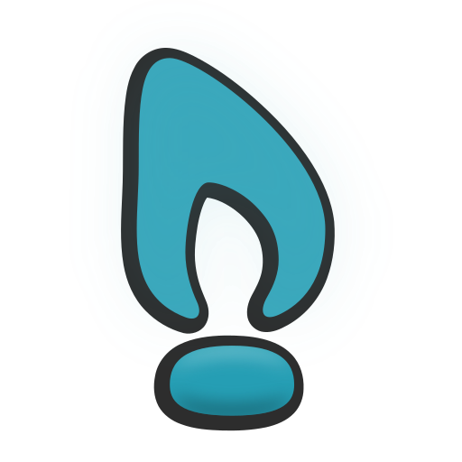

The desktop and compositor are named **澄境 / Clarion**. Write **Clarion** with a capital C in prose and use lower-case in commands and file paths (`clarion`, `clarion-session`, `~/.config/clarion/`).

Existing command names and user data remain compatible during the rename. See the
[migration guide](../clarion-migration.md) for configuration and IPC precedence.

Logo:

